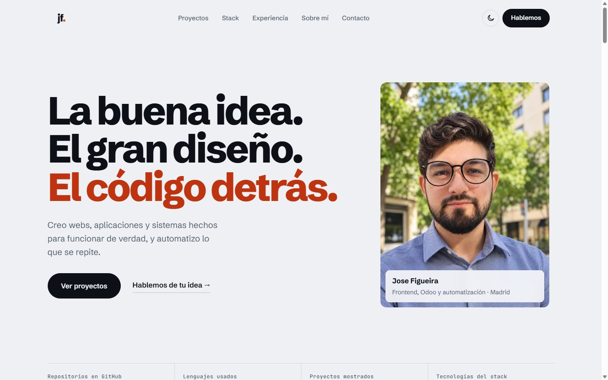
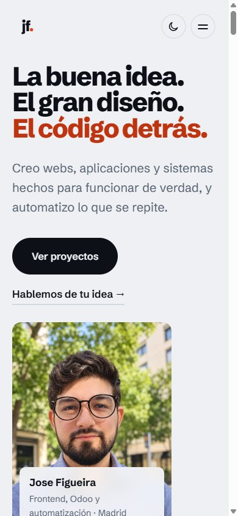

# Portafolio de Jose Figueira

Portafolio personal de **Jose Figueira**, desarrollador en Madrid. Reúne 14 proyectos reales (webs de clientes, aplicaciones, sistemas a medida, automatizaciones y un videojuego), con capturas de los sitios publicados, y un stack de 42 tecnologías donde cada una indica el proyecto en el que se ha usado.

**Web:** https://figueira205.github.io/Portafolios/



<p>
  
</p>

## Secciones

| Sección | Qué muestra |
|---|---|
| **Inicio** | Presentación, retrato y cuatro cifras sacadas de GitHub: repositorios, lenguajes, proyectos y tecnologías |
| **Proyectos** | 14 tarjetas filtrables por Web, Aplicaciones, Sistemas y Juegos y 3D. Cada una abre un detalle con contexto, trabajo realizado y tecnología |
| **Stack** | Reparto de lenguajes por volumen de código en GitHub y 42 tecnologías en 7 áreas, con el proyecto de ejemplo de cada una |
| **Experiencia aplicada** | Cuatro bloques de trabajo: sector jurídico, comercio y turismo, producto y plataformas, automatización y juegos |
| **Sobre mí** | Enfoque de trabajo y principios |
| **Contacto** | Correo (con botón de copiar), LinkedIn y GitHub |

## Proyectos incluidos

| Proyecto | Tipo | Tecnología destacada |
|---|---|---|
| Cátedra de la Hispanidad | Plataforma web | Django, Wagtail, Stripe, PostgreSQL, Docker |
| Creditaria Estudio Legal | Web y editor a medida | Odoo, React, TipTap, Express |
| Melkart Náutica | Reservas online | Web bilingüe, reservas y pagos |
| Ramírez de Losada | Tienda online | WooCommerce, WordPress |
| Odoo a medida | Sistemas | Módulos y temas en Python, XML-RPC |
| Domi-QR | Aplicación | Vue 3, Vite, Supabase |
| Figueira Hideaway | Sistema | React, Node, RabbitMQ, PostgreSQL |
| Planes de Pago | Calculadora | JavaScript, jsPDF |
| Cointhrive (panel y web) | Fintech | JavaScript, SVG |
| Fratelli d'Italia | Sitio web | HTML, CSS, JavaScript |
| Farmaluna | Videojuego | Unity 6, C#, Blender |
| Procesos que se conectan | Automatización | n8n, Make, Gemini API |
| Exoneris Abogados | Web corporativa | UX/UI y SEO |

## Cómo está hecho

- **Sin compilación ni dependencias.** HTML, CSS y JavaScript puros, alojados en GitHub Pages.
- **Capturas reales.** Las imágenes de proyecto son capturas de los sitios publicados, optimizadas en WebP, dentro de un marco de navegador. Los proyectos sin captura pública (sistemas, juego, automatización) usan portadas tipográficas, no maquetas inventadas.
- **Datos verificables.** Las cifras de lenguajes salen de la API de GitHub de mis repositorios; el stack se apoya en los `package.json`, `requirements.txt` y módulos de cada proyecto.
- **Tema claro y oscuro.** Sigue el sistema y se puede cambiar con el botón; la elección se recuerda.
- **Movimiento con propósito.** Titular que entra por líneas, retrato con inclinación suave, botones magnéticos, barra de progreso de lectura y marcos que recorren la captura al pasar el cursor. Todo se desactiva con `prefers-reduced-motion`.
- **Accesibilidad.** Enlace de salto, foco visible, diálogo nativo con cierre por Escape y devolución del foco, filtros con `aria-pressed`, contador anunciado y menú móvil con estado expandido.
- **SEO.** Metadatos, Open Graph y datos estructurados de tipo `Person`.

## Estructura

| Archivo | Función |
|---|---|
| `index.html` | Contenido, tarjetas de proyecto y plantillas de detalle (`<template>`) |
| `styles.css` | Sistema de diseño: tokens de color para claro y oscuro, componentes y adaptación |
| `main.js` | Tema, menú, filtros, diálogo de detalle, copiar correo y efectos del cursor |
| `assets/jose.webp` | Retrato |
| `assets/work/` | Capturas de los proyectos en WebP |
| `docs/` | Capturas para este README |

## Ejecutar en local

```bash
git clone https://github.com/Figueira205/Portafolios.git
cd Portafolios
python -m http.server 8000
```

Abre http://localhost:8000.

## Añadir un proyecto

1. Guarda la captura en `assets/work/` (WebP, 1200 px de ancho).
2. Duplica un `<article class="work">` en `index.html` y ajusta su texto, etiquetas y enlaces. En `data-cat` van las categorías del filtro: `web`, `apps`, `systems` o `games`.
3. Añade su `<template id="t-...">` con las secciones del detalle; el valor de `data-open` de la tarjeta debe coincidir con ese identificador.
4. Actualiza el contador del botón «Todos», el texto «N proyectos» y la cifra de proyectos de la franja inicial.

## Notas de contenido

- Los proyectos de clientes (Creditaria, Ramírez de Losada) enlazan a sus sitios en producción.
- «Farmaluna» es un proyecto en desarrollo con repositorio privado; por eso no tiene enlace.
- La sección de experiencia describe especializaciones y proyectos, no una cronología laboral.
